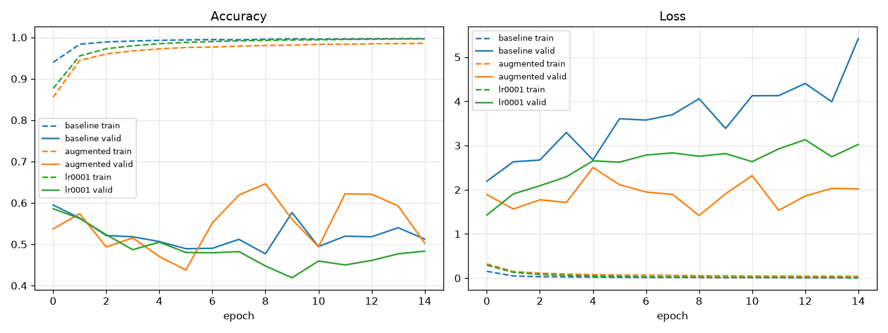

# Experiments on the Drowsiness Detection CNN

Based on [shsarv/Machine-Learning-Projects — Drowsiness detection [OPEN CV]](https://github.com/shsarv/Machine-Learning-Projects/tree/main/Drowsiness%20detection%20%5BOPEN%20CV%5D).
The original project (Haar cascades + a small Keras CNN, `model.py` → `models/cnnCat2.h5`) is unchanged in structure;
only the experiments below were added.

## Setup

| Item | Value |
|---|---|
| Model | Original CNN from `model.py` (3× Conv2D 32/32/64, Dense 128, Dropout 0.25/0.5, softmax 2) — architecture unchanged |
| Input | 24×24 grayscale eye crop, scaled to 0–1 (same as `drowsinessdetection.py`) |
| Dataset | [Driver Drowsiness Dataset (DDD)](https://www.kaggle.com/datasets/ismailnasri20/driver-drowsiness-dataset-ddd), 41,791 face images, via the public HF mirror `akahana/Driver-Drowsiness-Dataset` |
| Preprocessing | `prepare_data.py`: project's own Haar eye cascades crop left + right eye from each face → 24×24. Drowsy → `Closed`, Non Drowsy → `Open` |
| Split | **By subject** (no person appears in two splits): train 19 subjects (59,671 eyes), valid 4 (7,801), test 5 (14,968) |
| Training | Adam, lr 0.001, batch 32, 15 epochs (original settings); seed 42 |
| Metrics | On the held-out test subjects; Precision / Recall / F1 for the `Closed` (alarm) class |

## Experiments

1. **Baseline** – original pretrained `cnnCat2.h5` evaluated as-is, and the same model retrained with the original settings on DDD.
2. **Data augmentation** – rotation ±10°, zoom ±10 %, brightness ±20 %, horizontal flip on training images only (`--augment`).
3. **One parameter change** – learning rate 0.001 → 0.0001 (`--lr 0.0001`), everything else identical.

## Results (test set: 14,968 eye crops from 5 unseen subjects)

| Model | Accuracy | Precision | Recall | F1 |
|---|---|---|---|---|
| Original cnnCat2.h5 (no retraining) | 0.4817 | 0.4615 | 0.3275 | 0.3831 |
| Baseline (retrained) | **0.5372** | **0.5280** | **0.5506** | **0.5390** |
| Augmented | 0.4735 | 0.4439 | 0.2817 | 0.3446 |
| Learning rate 0.0001 | 0.4592 | 0.4339 | 0.3297 | 0.3747 |

Confusion matrices: `results/cm_*.png` · Training curves: `results/training_curves.png`



## Conclusion

- The retrained baseline did best on unseen people (F1 0.539), but every model is close to chance (~50 %).
- All three training runs reach ~99 % **training** accuracy while validation stays at 45–65 %: the CNN memorises
  the 19 training subjects instead of learning a general "closed eye" pattern (strong overfitting).
- Augmentation lowered training accuracy (98.6 % vs 99.7 %) and gave the lowest validation loss and the single best validation epoch (64.6 % at epoch 9),
  but the final (epoch 15) model was worse on test. A lower learning rate only slowed learning down; it did not
  improve generalisation.
- Main reason: DDD labels the **whole face** as Drowsy / Non Drowsy, but this model only sees a 24×24 **eye** crop.
  A drowsy driver's eyes are not closed in every frame (the original model judged only 36 % of Drowsy eye crops as closed
  in a check on 600 test faces), so the eye-level labels are noisy.
- A random frame-level split would score much higher, but only because near-identical frames of the same person
  would be in both train and test; the subject-wise split here measures real generalisation.

## How to reproduce

```bash
python -m venv .venv
.venv\Scripts\activate
pip install -r requirements.txt
# put the 7 DDD parquet shards in data/raw/ (from huggingface.co/datasets/akahana/Driver-Drowsiness-Dataset/tree/main/data)
python prepare_data.py                      # builds data/train, data/valid, data/test eye crops
python model.py --name baseline             # Experiment 1
python model.py --name augmented --augment  # Experiment 2
python model.py --name lr0001 --lr 0.0001   # Experiment 3
python evaluate.py                          # metrics table, confusion matrices, curves -> results/
```
